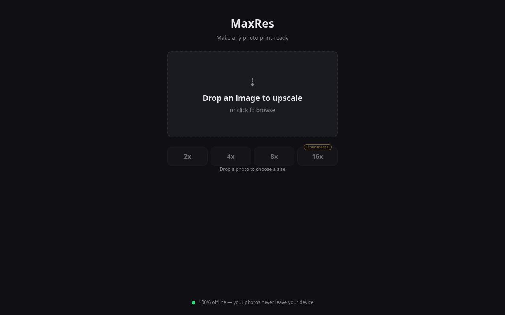

# MaxRes

**Make any photo print-ready — free, private, and stupidly simple.**

MaxRes is a free, 100% offline AI image upscaler. Drop a photo in, pick a size
(2x, 4x, 8x, or 16x), and get a crisp, print-ready image saved right next to
the original. Your photos never leave your device — no accounts, no uploads,
no telemetry, no network calls.

## Preview



## Why MaxRes?

- **Free forever** — no subscriptions, no paywalls
- **100% offline** — the AI runs on your own computer; your photos stay private
- **Stupidly simple** — one screen: drop, click a size, done
- **Up to 16x** — enlarge small or old photos for printing and framing

## How it works

MaxRes bundles [Real-ESRGAN](https://github.com/xinntao/Real-ESRGAN)
(`realesrgan-ncnn-vulkan`), a pre-built AI upscaling engine, and runs it locally
on your GPU. The app orchestrates the sizes:

| Size | How it's made                                        |
| ---- | ---------------------------------------------------- |
| 4x   | one native AI pass                                   |
| 2x   | 4x pass, then a high-quality shrink                  |
| 8x   | 4x pass → shrink → 4x pass                           |
| 16x  | two 4x passes (labelled experimental — large & slow) |

## Install

Download the installer for your system from the
[Releases page](../../releases):

- **Windows:** `.msi` or `.exe`
- **macOS:** `.dmg`
- **Linux:** `.AppImage`, `.deb`, or `.rpm`

> **Note on security warnings:** MaxRes is a free, open-source project and its
> installers are not code-signed (signing certificates cost money we don't
> charge you for). Your system may warn that the app is from an
> "unidentified developer":
>
> - **Windows:** click **More info → Run anyway**
> - **macOS:** right-click the app → **Open** → **Open**

## Development

Built with [Tauri v2](https://tauri.app) + React + TypeScript + Vite.

```bash
npm install          # install dependencies
npm run tauri dev    # run in development
npm test             # unit tests (Vitest)
npm run lint         # ESLint + Prettier
npm run tauri build  # build installers
```

You also need [Rust](https://rustup.rs) and, on Linux, the
[Tauri system dependencies](https://tauri.app/start/prerequisites/).

The AI engine binaries live in `src-tauri/binaries/` (named per platform
target triple). See [`agent_docs/tech_stack.md`](agent_docs/tech_stack.md) for
architecture details.

## Privacy

MaxRes has **no network permission at all**. It cannot phone home, and there is
no analytics or telemetry. The only thing it stores is a local counter of how
many images you've upscaled, kept in a file on your own device.

## License

MaxRes is licensed under the [GNU General Public License v3.0](LICENSE).

It bundles Real-ESRGAN, which is BSD-3-Clause licensed — see
[`THIRD_PARTY_LICENSES.md`](THIRD_PARTY_LICENSES.md) for full attributions.
